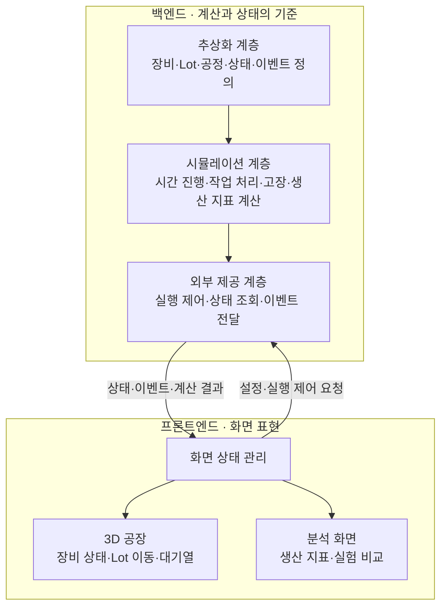

# 자율팹팹 | 반도체 생산 시스템 3D 시뮬레이션

**아주대학교 「아주마스터클래스 2026-2」 자율팹팹 팀의 프로젝트 결과물을 개발하고 기록하는 저장소입니다.**

반도체 생산 시스템을 모델링하는 **OpenFab** 프로젝트로, 장비 수준의 상태 변화가 공장 전체의 생산 흐름과 성능에 어떤 영향을 주는지 탐구합니다. Python 기반 시뮬레이션으로 공정·장비·Lot의 동작을 계산하고, 그 결과를 3D 화면과 생산 지표로 확인할 수 있는 시스템을 목표로 합니다.

> 현재 단계: 초기 설계 및 개발 준비. 아래 기능과 디렉터리 구조는 개발 목표와 설계안이며, 구현 완료를 의미하지 않습니다.

## 프로젝트 정보

| 항목 | 내용 |
| --- | --- |
| 프로그램 | 아주대학교 아주마스터클래스 2026-2 |
| 팀명 | 자율팹팹 |
| 프로젝트 | OpenFab: 반도체 생산 시뮬레이터 개발 및 디지털 트윈 기반 제조 시스템 탐구 |
| 활동 기간 | 2026년 9월 ~ 2027년 1월 |
| 팀원 | 김명민, 김현준 |
| 저장소 | [buuung/sc-factory-digital-twin](https://github.com/buuung/sc-factory-digital-twin) |

## 개발 목표

- 공정·장비·Lot·대기열을 모델링하고 생산 흐름을 시뮬레이션합니다.
- SEMI E10의 장비 상태 분류를 반영하여 상태 변화와 상태별 체류시간을 기록합니다.
- 생산량, 사이클타임, 공정별 대기시간, 장비 가동률 등 생산 운영 지표를 계산합니다.
- 장비 수, 처리시간, Lot 투입 조건, 처리 순서 규칙을 변경하며 병목과 생산성 변화를 비교합니다.
- 동일한 시뮬레이션 결과를 3D 장비 상태, Lot 이동, 대기열 및 그래프로 표현합니다.
- 코드와 함께 설계 근거, 검증 결과, 시행착오, 기술 영상 및 발표 자료를 기록합니다.

공정 수치 계산의 초기 범위는 **처리시간·대기시간·생산량 등 생산 운영 수치**입니다. 식각 반응이나 증착 두께 등을 계산하는 물리 공정 모델은 별도 확장 영역입니다.

## 개발 우선순위

**업계 표준을 반영한 3D 생산 시뮬레이션을 먼저 완성합니다.**

1. 공통 모델과 상태·이벤트 규칙 정의
2. Python 생산 시뮬레이션 및 수치 검증
3. OpenUSD 기반 3D 표현과 결과 재생
4. 실험 비교, 통합 검증 및 문서화
5. 시간이 남을 경우 ESP32·라즈베리파이 등을 이용한 실물 프로토타입 연결

실물 제작은 선택 과제이며, 초기 시뮬레이션 개발의 선행 조건이 아닙니다. Isaac Sim 반송 로봇 구현은 현재 개발 범위에서 제외합니다.

## 시스템 구조

백엔드는 **추상화 계층과 시뮬레이션 계층을 분리**하고, 프론트엔드는 백엔드가 제공하는 결과를 표시합니다.



| 계층 | 책임 |
| --- | --- |
| 추상화 계층 | 장비·Lot·공정의 공통 개념, 장비 상태, 상태 전환 규칙과 이벤트 정의 |
| 시뮬레이션 계층 | 가상 시간 진행, 자원 배정, 대기열, 고장·수리, 생산 운영 수치 계산 |
| 외부 제공 계층 | 실험 설정 입력, 실행 제어, 상태 스냅샷과 이벤트 제공 |
| 프론트엔드 | 3D 장면, 지표·그래프, 실험 결과 재생과 사용자 조작 |

### 설계 원칙

- 생산 결과를 결정하는 상태와 시간은 백엔드가 관리합니다.
- 프론트엔드는 상태·이벤트를 바탕으로 색, 위치, 애니메이션과 그래프를 표현합니다.
- 추상화 계층의 핵심 모델과 규칙은 SimPy 및 3D 도구에 직접 의존하지 않도록 설계합니다.
- 로그, 지표, 3D 표현은 동일한 실행 결과를 사용합니다.
- 저장된 결과의 화면 재생 속도를 바꿔도 계산된 생산 결과는 변하지 않습니다.
- 시뮬레이션의 가상 시간과 향후 실물 관찰의 실제 시간은 구분합니다.

## Python 객체지향 모델

상태와 동작을 가진 대상은 클래스로 표현하고, 단순 계산은 함수, 상태 종류는 `Enum` 등으로 구분합니다.

| 모델 | 역할 |
| --- | --- |
| `Equipment` | Python `Protocol`로 Lot 입력·공정 처리·Lot 출력의 공통 계약 정의 |
| `RecipeEquipment` | `Equipment` 계약을 만족하며 YAML의 단계와 등록된 동작을 조합하는 공통 구현 |
| `Lot` | 제품 묶음의 공정 경로, 현재 단계와 생산 이력 |
| `ProcessStep` | 공정 단계별 장비 요구사항과 처리 조건 |
| `Dispatcher` | 대기 중인 Lot의 처리 순서 결정 |
| `Simulation` | 가상 시간과 전체 실행 흐름 관리 |
| `Event` | 특정 시점에 발생한 상태·작업 변화 기록 |

장비와 공정 단계에는 고유 ID를 부여합니다. 같은 장비를 여러 번 방문하는 재진입 공정에서도 방문 단계와 장비를 구분할 수 있도록 설계합니다.

### 장비 Protocol과 설정 기반 확장

`Equipment`의 공개 동작은 다음 세 가지를 기본으로 합니다.

| 동작 | 책임 |
| --- | --- |
| `receive_lot(lot)` | 입력 Lot의 조건과 수용 가능 여부를 검사하고 장비에 인계 |
| `process()` | 장비에 입력된 Lot에 적용할 레시피와 단계별 동작 정의 |
| `release_lot()` | 공정 및 필요한 정리 동작이 끝난 Lot과 처리 결과를 출력 |

Python의 `typing.Protocol`로 공통 계약을 정의합니다. 구현 클래스는 `Equipment`를 직접 상속하지 않아도 필요한 메서드와 타입을 갖추면 계약을 만족합니다. 계약의 타입 적합성은 mypy나 Pyright 같은 정적 타입 검사기로 확인하며, Protocol 자체가 실행 중 호출 조건을 검증하는 것은 아닙니다. 대기 중인 Lot의 배정, 가상 시간 진행, 난수 추출 및 단계 실행은 시뮬레이션 계층에서 담당하며, 공통 계약은 SimPy 환경이나 3D 객체에 의존하지 않습니다.

공통 구현 클래스 `RecipeEquipment`가 설정 파일의 레시피와 단계별 동작을 조합합니다. 처리 순서·시간·확률만 다른 장비는 YAML과 인스턴스로 구분하며, 장비마다 새 자식 클래스를 만들지 않습니다. 배치 처리 등 실행 방식 자체가 달라지는 경우에는 같은 `Equipment` 계약을 만족하는 별도 구현 클래스를 추가합니다.

설정의 `equipment_type`을 등록된 장비 생성 규칙에 대응시키는 팩토리를 둡니다. 여러 장비 종류가 공통 `RecipeEquipment` 구현을 사용할 수 있습니다. 설정 파일은 장비 종류와 동작, 실행 순서, 수치를 선택합니다. 새 동작의 Python 구현은 별도로 등록하며, 설정에서 Python 코드나 클래스를 동적으로 생성·실행하지 않습니다.

### 장비 설정과 레시피: YAML

장비 설정에는 주석과 단계별 목록을 작성하기 쉬운 YAML을 사용합니다. 이벤트 교환에는 JSON을 사용합니다. YAML은 `PyYAML.safe_load`로 읽고 Pydantic 모델과 별도 규칙 검증을 거쳐 실행 가능한 설정으로 변환합니다.

아래 예시는 **설계 설명을 위한 임의의 시간과 확률**입니다. 실제 반도체 장비의 특성값이나 구현 완료된 설정 규격을 의미하지 않습니다.

```yaml
schema_version: 1
equipment_id: ETCH_01
equipment_type: etching
input:
  accepted_lot_types: [wafer]
  capacity_lots: 1
output:
  normal_route: next_process
  defective_route: hold
recipe:
  id: etch_demo_v1
  steps:
    - id: evacuate
      action: pump_down
      duration_s: 30
    - id: etch
      action: etch
      duration_s: 90
      defect:
        probability: 0.02
        basis: per_lot_per_step_execution
        sample_at: step_completed
        effect: mark_lot_defective
    - id: restore_pressure
      action: vent
      duration_s: 15
```

- `recipe.steps`의 목록 순서대로 진공 형성 → 처리 → 복압 동작을 실행합니다. 초기 버전은 순차 레시피로 제한합니다.
- 각 `action`은 사전에 등록된 동작 구현을 가리킵니다. 새로운 순서와 수치는 YAML에서 조합하고, 새로운 동작의 의미는 Python 코드로 구현합니다.
- 입력 수용 조건과 출력 조건을 함께 검사하여 중복 입력·출력과 처리 중 조기 출력을 방지합니다.
- 장비 ID, 공정 경로의 단계 ID, 장비 내부 레시피의 단계 ID를 구분하여 재진입과 반복 실행을 기록합니다.
- 실행 시 사용한 설정의 사본·버전과 난수 시드를 결과와 함께 보관합니다.

설정 검증에서는 알 수 없는 필드·장비 종류·동작 이름, 중복 YAML 키·단계 ID, 잘못된 자료형, 범위를 벗어난 확률, 음수 시간, 허용되지 않은 단계 순서를 확인합니다. 알려지지 않은 값을 기본값으로 바꾸어 실행하지 않고 원인을 표시합니다. 단계 순서는 장비별 선행 조건과 사후 조건으로 검사합니다.

### 불량·장비 고장·프로그램 오류의 구분

| 종류 | 모델링과 처리 |
| --- | --- |
| 제품 불량 | 시뮬레이션 결과로 Lot의 품질 상태를 기록하고 보류·폐기·재작업 등 합의된 경로로 분기 |
| 장비 고장 | 장비 상태를 바꾸고 공정을 중단하며, 수리와 재개·재시작 규칙을 적용 |
| 설정·프로그램 오류 | 잘못된 설정이나 불가능한 호출 등을 예외로 보고하여 수정 |

위 예제의 불량 확률 `0.02`는 해당 단계를 완료한 Lot마다 실행 1회당 한 번 추첨한다는 뜻입니다. 초당 고장 확률이나 개별 웨이퍼 불량률을 뜻하지 않습니다. 단계가 반복되면 매 실행마다 새로 추첨하며, 독립 추첨 여부를 실험 가정에 기록합니다.

불량 발생 시에도 위 예제에서는 Lot에 표시만 하고 복압까지 수행한 후 보류 경로로 출력합니다. 장비 고장으로 중단되는 경우에는 복구·정리 조건을 충족하기 전 Lot을 정상 출력하지 않습니다. 제품 불량을 Python 예외로 발생시켜 전체 시뮬레이션을 종료하지 않습니다.

장비 내부의 진공 형성·처리·복압 단계와 E10 상태는 별도로 관리합니다. 내부 단계 변화마다 E10 상태가 바뀌는 것은 아니며, 운영 조건에 따른 분류 규칙을 문서화합니다.

## 표준 반영 범위

### SEMI E10

생산, 대기, 엔지니어링, 계획 정지, 비계획 정지, 비가동 계획 시간의 여섯 가지 기본 분류를 참고하여 장비 상태와 시간을 관리합니다.

상태 이름뿐 아니라 분류 조건, 전환 기록, 관찰 구간과 지표 계산 기준을 문서화합니다. 구현한 범위와 단순화한 가정을 명시하며, 표준 전체의 준수를 전제하지 않습니다.

### SECS/GEM

초기에는 SECS/GEM의 이벤트 보고 개념을 참고한 **프로젝트 내부 이벤트 인터페이스**를 구현합니다. 장비 ID, Lot ID, 공정 단계 ID, 발생 시각, 이벤트 종류 및 상태 변화 등을 공통 형식으로 기록합니다.

내부 JSON 이벤트 전달과 실제 SECS/GEM 프로토콜 통신은 구분합니다. 실제 통신은 후속 선택 과제로 두며, 도입 시 별도의 통신 어댑터와 장비·Host 간 검증을 진행합니다.

### OpenUSD

장비·공정 배치와 시간에 따른 3D 속성을 표현하는 데 사용합니다. 백엔드의 장비 ID를 3D 객체와 연결하고, 상태 변화와 Lot 이동을 화면에 반영합니다.

OpenUSD 장면 생성, 기록된 결과의 재생, 실행 중 상태의 실시간 반영은 단계별로 구분하여 구현합니다.

## 기술 구성

| 영역 | 기술 및 계획 |
| --- | --- |
| 주 개발 언어 | Python |
| 생산 시뮬레이션 | SimPy |
| 공통 모델 | Python `Protocol`, 클래스, `dataclass`, `Enum` |
| 장비 설정·검증 | YAML, PyYAML, Pydantic |
| 3D 연결 | OpenUSD Python API, USD 뷰어 |
| 환경·협업 | uv, Git, GitHub |
| 검증 | pytest 기반 동작·계산 검증 |
| 외부 제공 계층 | FastAPI 도입 예정 |
| 분석·화면 | pandas, Plotly, Streamlit 등을 검토하며 3D 뷰어와의 역할 확정 |

패키지 버전과 구체적인 실행 환경은 초기 구현 과정에서 검증하고 고정할 예정입니다.

## 예정 디렉터리 구조

```text
sc-factory-digital-twin/
├─ backend/
│  ├─ domain/          # 공통 모델·상태·이벤트·규칙
│  ├─ simulation/      # 가상 시간·공정 흐름·수치 계산
│  └─ api/             # 실행 제어·상태·이벤트 제공
├─ frontend/           # 3D 표현·그래프·재생 조작
├─ contracts/          # 계층 간 데이터 규격·예시
├─ configs/            # 공정·장비·실험 조건
├─ tests/              # 모델·계산·연결 검증
├─ docs/               # 구조·표준 적용·로드맵·활동 기록
└─ README.md
```

## 팀 역할

| 팀원 | 중심 역할 |
| --- | --- |
| 김명민 | 반도체 공정 흐름과 장비 조건 조사, 처리 순서 규칙과 생산 실험 설계, 데이터 분석·결과 해석 |
| 김현준 | 장비·이벤트 모델링, 시뮬레이션 구조와 통합, 백엔드·프론트엔드 연결, 3D 표현 |

주요 설계와 실험 결과는 공동으로 검토합니다. AI 도구는 조사·설계·코드 작성·오류 분석의 보조 수단으로 활용하며, 생성된 결과를 직접 실행·검증·수정하고 동작 원리를 설명할 수 있도록 학습합니다.

## 개발 일정

팀 계획을 기준으로 하며, 세부 일정은 진행 상황에 따라 조정합니다.

| 시점 | 목표 |
| --- | --- |
| 2026년 9월 말 ~ 10월 초 | 공통 모델·이벤트 형식 정의, 장비 모델과 계산 검증 |
| 2026년 10월 18일 | 중간발표용 기능 동결, 최소 3D 상태 표시 데모 확보 |
| 2026년 11월 4일 | 중간보고 및 프로토타입 시연 |
| 2026년 11월 | 전체 공정의 3D 표현, Lot 이동·대기열·결과 재생과 비교 |
| 2026년 12월 11일 | 핵심 구현·통합 검증 완료 및 기능 동결 |
| 2026년 12월 말 ~ 2027년 1월 | 공개 자료·최종보고서·영상·발표 준비 |
| 2027년 1월 15일 | 최종 결과 발표 |

## 첫 구현 목표와 검증 기준

- [ ] 장비 1대와 Lot 2개를 모델링합니다.
- [ ] 작업 시작·완료와 장비 상태 변화를 이벤트로 기록합니다.
- [ ] 예상 처리시간·대기시간과 시뮬레이션 결과를 비교합니다.
- [ ] 고장·수리 시 작업 중단과 재개 규칙을 검증합니다.
- [ ] 상태별 체류시간의 합이 관찰시간과 일치하는지 확인합니다.
- [ ] 백엔드 상태와 3D 표현의 장비 ID·시각·상태가 일치하는지 확인합니다.

실행 명령과 설치 절차는 초기 구현 및 재현 검증이 완료되면 추가합니다.

## 참고 자료

- [SEMI E10 공식 개요](https://store-us.semi.org/products/e01000-semi-e10-specification-for-definition-and-measurement-of-equipment-reliability-availability-and-maintainability-ram-and-utilization)
- [SimPy 공식 문서](https://simpy.readthedocs.io/en/stable/)
- [OpenUSD 공식 문서](https://openusd.org/release/index.html)
- [secsgem 프로젝트](https://github.com/bparzella/secsgem)
- [Python Protocol](https://docs.python.org/3.12/library/typing.html#typing.Protocol)
- [PyYAML 공식 문서](https://pyyaml.org/wiki/PyYAMLDocumentation)
- [Pydantic 모델 검증](https://docs.pydantic.dev/latest/concepts/models/)
