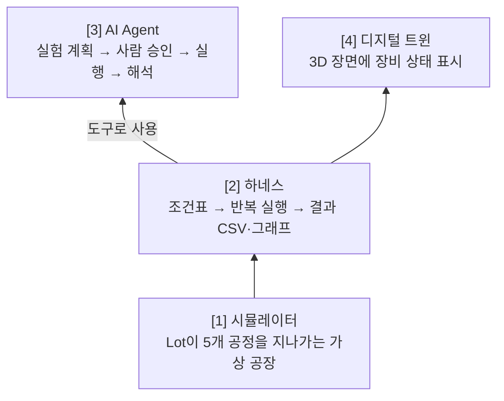

# 자율팹팹 | OpenFab

**아주대학교 「아주마스터클래스 2026-2」 자율팹팹 팀의 프로젝트 결과물을 개발하고 기록하는 저장소입니다.**

> 반도체 공장을 컴퓨터 안에 작게 만들고(OpenFab), 실험을 자동으로 돌리는 하네스를 붙인 뒤, AI Agent가 그 하네스로 병목을 찾게 만듭니다. 마지막에 3D 디지털 트윈을 맛보기로 붙입니다.

> 현재 단계: 시뮬레이터·하네스 기본 구조 구현. 공정별 장비 수·처리시간은 명민 조사값 v0.1([docs/process_params.md](docs/process_params.md))이며, AI Agent 루프와 디지털 트윈은 구현 전입니다.

## 프로젝트 정보

| 항목 | 내용 |
| --- | --- |
| 프로그램 | 아주대학교 아주마스터클래스 2026-2 |
| 팀명 | 자율팹팹 |
| 프로젝트 | OpenFab: 반도체 생산 시뮬레이터와 실험 하네스, 하네스를 도구로 쓰는 AI Agent |
| 활동 기간 | 2026년 9월 ~ 2027년 1월 (1인당 주 3~4시간, 시험 기간은 쉼) |
| 팀원 | 김명민, 김현준 |
| 저장소 | [buuung/sc-factory-digital-twin](https://github.com/buuung/sc-factory-digital-twin) |

## 왜 하는가

- **명민**: 반도체 제조 AI · Autonomous Fab(스스로 판단하는 공장)이 실제로 어떻게 돌아가는지 작게라도 직접 이해합니다.
- **현준**: 장비의 상태·이벤트를 소프트웨어로 모델링하는 임베디드 관점을 공장 전체로 넓히고, 시뮬레이터·하네스·Agent를 직접 만듭니다.

## 비유로 이해하기: 놀이공원

| 놀이공원                          | OpenFab                                  |
| ----------------------------- | ---------------------------------------- |
| 손님 무리                         | **Lot** (웨이퍼 묶음)                         |
| 놀이기구 5개를 순서대로 탐               | 공정 5개를 순서대로 지남 (포토 → 식각 → 증착 → CMP → 검사) |
| 놀이기구가 꽉 차면 줄을 섬               | 장비가 바쁘면 **대기열**에서 기다림                    |
| 줄이 제일 긴 놀이기구                  | **병목** 공정                                |
| "그 놀이기구를 하나 더 만들면 줄이 얼마나 줄까?" | "병목 공정에 장비를 추가하면 생산량이 얼마나 늘까?"           |

## 핵심 질문

- **반도체 제조**: 어느 공정이 병목이고, 장비를 어디에 추가해야 생산량이 가장 많이 늘까? 왜 그런지 데이터로 설명할 수 있을까?
- **AI**: AI가 하네스로 실험을 계획·실행하고 근거를 들어 판단할 수 있을까? 데이터가 없을 때는 지어내지 않고 "모른다"고 말할 수 있을까?

## 전체 구조 · 4층



| 층          | 하는 일                                                         | 우선순위 | 상태           |
| ---------- | ------------------------------------------------------------ | ---- | ------------ |
| 1 시뮬레이터    | Lot이 5개 공정을 순서대로 지나감. 장비가 바쁘면 줄을 섬. **생산량, 대기시간, 장비 가동률** 계산 | 필수   | 기본 구현        |
| 2 하네스      | 조건표를 받아 시뮬레이터를 자동 반복 실행하고 결과를 CSV로 남김. 같은 seed면 같은 결과        | 필수   | 기본 구현        |
| 3 AI Agent | 시뮬레이터를 직접 만지지 않고 **하네스를 통해서만** 실험. 실행 전 사람 승인, 모든 호출 기록      | 필수   | 도구·승인 장치만 구현 |
| 4 디지털 트윈   | 결과를 3D 공장 화면에 표시 (일하면 초록, 기다리면 빨강)                           | 맛보기  | 미착수          |

## 원칙

1. **공장은 작아도 정확하게.** 공정 5개, 바꾸는 값은 장비 수·처리시간·투입량 정도만.
2. **하네스가 중심.** 사람이든 AI든 실험은 하네스를 통해서만 돌립니다. 그래야 모든 실험이 기록되고 재현됩니다.
3. **주고받는 형식은 고정.** 명민이 조건표(무엇을 몇 단계로 바꿀지)를 주면, 하네스가 실행하고 결과표를 돌려줍니다.
4. **AI는 보조, 판단은 직접.** AI 결과는 명민이 데이터로 검증합니다.
5. **시험 기간은 완전히 쉽니다.**

## 범위

| 항목 | 내용 | 사용 기술 |
| --- | --- | --- |
| 공장 | 공정 5개, 공정마다 장비 수와 처리시간 설정, 장비가 바쁘면 대기 | Python + SimPy (이산 사건 시뮬레이션) |
| 측정값 | 생산량 / 대기시간 / 장비 가동률 | throughput, avg wait, utilization |
| 하네스 | 조건표 → 반복 실행 → 결과 CSV → 그래프. 무작위 값은 seed로 고정 | Python, CSV, matplotlib |
| AI 도구 | 실험 돌리기 / 지난 결과 찾기 / 그래프 그리기 | `run_experiment`, `search_results`, `plot` |
| AI 구현 | Claude 또는 OpenAI API의 기본 기능만 사용 | tool calling (프레임워크 없이) |
| 안전장치 | 실험 전에 사람에게 "실행할까요? y/n"을 물음 | 승인 게이트 |
| 디지털 트윈 | 장비 상태를 3D 장면에 색으로 표시 | OpenUSD (usd-core) |

**하지 않는 것**: 실제 공장 데이터, 실물 장비·센서 연결, 웹 화면, 데이터베이스, 장비 고장 모델. 다음 학기 이후 확장 후보로 둡니다.

## 디렉터리 구조

```text
sc-factory-digital-twin/
├─ configs/
│  ├─ factory.yaml            # 기준 공장: 공정 순서·장비 수·처리시간·투입량
│  └─ experiments/            # 실험 조건표 (무엇을 몇 단계로 바꿀지)
├─ eval/
│  └─ questions.yaml          # AI Agent 시험 문제와 정답
├─ src/openfab/
│  ├─ sim/                    # [1] 시뮬레이터: 설정 검증, SimPy 공장, 결과 자료형
│  ├─ harness/                # [2] 하네스: 조건표 펼치기, 반복 실행, CSV, 그래프
│  ├─ agent/                  # [3] AI Agent: 도구 3개, 승인 게이트, 호출 기록
│  └─ theory.py               # 관계식(이론값): 시뮬레이션 결과와 비교
├─ docs/
│  ├─ formulas.md             # 관계식의 식·출처·가정 정리
│  └─ process_params.md       # 공정 입력값과 근거·출처
├─ tests/                     # 계산·재현성·승인·관계식 검증
└─ results/                   # 실행 결과 (git에 올리지 않음)
```

## 실행 방법

[uv](https://docs.astral.sh/uv/)로 환경을 구성합니다.

```bash
uv sync                                                   # 의존성 설치
uv run pytest                                             # 테스트
uv run python -m openfab.harness configs/experiments/example.yaml
```

실행하면 `results/<실험 이름>/`에 다음이 생깁니다.

| 파일 | 내용 |
| --- | --- |
| `experiment.yaml` | 실행에 쓴 조건표와 기준 설정 사본 (재현용) |
| `results.csv` | 실행 1회당 한 줄: 바꾼 값, seed, 생산량, 사이클타임, 병목, 공정별 대기시간·가동률 |

그래프는 다음과 같이 그립니다.

```python
from openfab.harness.plot import plot_results
plot_results("results/example_photo_machines/results.csv",
             x="processes.photo.machines", y="throughput_per_hour", group_by="release.interval")
```

## 주고받는 형식

### 기준 공장 (`configs/factory.yaml`)

```yaml
processes:              # 위에서부터 순서대로 지나감
  - name: photo
    machines: 1
    process_time: 21    # 분 (평균)
  # ... etch, deposition, cmp, inspection
release:
  lots: 200             # 투입할 Lot 수
  interval: 24          # 투입 간격 (분)
randomness:
  process_time: exponential   # fixed | exponential
  arrival: fixed
```

숫자의 근거·출처와 손계산 결과는 [docs/process_params.md](docs/process_params.md)에 있습니다. 처리시간 삼각분포(최소/최빈/최대)는 아직 지원하지 않아 평균값을 씁니다.

### 실험 조건표 (`configs/experiments/*.yaml`)

```yaml
name: example_photo_machines
base: configs/factory.yaml
seeds: [1, 2, 3]
vary:                             # 모든 조합 × seed만큼 실행 (3 × 3 × 3 = 27회)
  processes.photo.machines: [1, 2, 3]
  release.interval: [24, 20, 15]
```

바꿀 수 있는 값: `processes.<공정>.machines`, `processes.<공정>.process_time`, `release.lots`, `release.interval`. 알 수 없는 키나 없는 공정 이름은 실행 전에 오류로 알립니다.

### 측정값

| 열 | 뜻 |
| --- | --- |
| `throughput_per_hour` | 첫 투입부터 마지막 완료까지의 시간당 완성 Lot 수 |
| `avg_cycle_time` | Lot 하나가 투입부터 완료까지 걸린 평균 시간 |
| `<공정>.avg_wait` | 그 공정 대기열에서 기다린 평균 시간 |
| `<공정>.utilization` | 장비가 실제로 일한 시간 ÷ (장비 수 × 전체 시간) |
| `bottleneck` | 가동률이 가장 높은 공정 |

## 역할 분담

| 층 | 김명민 · 반도체 제조 | 김현준 · 소프트웨어·임베디드 |
| --- | --- | --- |
| 1 시뮬레이터 | 공정 흐름 공부, 공정별 장비 수·처리시간 정하기, 결과가 상식에 맞는지 확인 | 시뮬레이터 코드, 장비 상태와 이벤트 모델링 |
| 2 하네스 | **실험 조건표 설계, 병목 분석과 해석** | 하네스 코드, 결과 저장, 그래프, 재현성(seed) |
| 3 AI Agent | AI 시험 문제 10개와 정답, AI 판단 검증, 틀린 이유 분석 | Agent 코드, 승인 장치, 로그, 자동 채점 |
| 4 디지털 트윈 | 디지털 트윈·Autonomous Fab 업계 사례 조사 | OpenUSD로 장비 상태 3D 표시 맛보기 |
| 정리 | 분석 보고서, 발표 흐름 | README, 구조 그림, 실행 방법 |

명민이 채울 자리는 코드와 설정에 `TODO(명민)`으로 표시되어 있습니다.

- `src/openfab/theory.py` + `docs/formulas.md`: Little's Law·대기시간 근사 관계식과 출처 (처리능력·병목·가동률은 채움). 채우면 `tests/test_theory.py`가 시뮬레이션 결과와 자동 비교
- `configs/experiments/`: 병목 실험 조건표
- `eval/questions.yaml`: AI 시험 문제 10개와 정답

AI 도구는 조사·설계·코드 작성·오류 분석의 보조 수단으로 활용하며, 생성된 결과를 직접 실행·검증·수정하고 동작 원리를 설명할 수 있도록 학습합니다.

## 성공 기준

- [ ] 시뮬레이터: Lot이 5개 공정을 지나가고 생산량·대기시간·가동률이 나온다
- [ ] 하네스: 조건표 하나로 여러 실험이 자동 실행되고 CSV와 그래프가 나온다. 같은 seed면 같은 결과
- [ ] 병목 실험: 병목 공정을 찾고, 장비 추가 전후 비교 그래프 1장 + 명민의 해석 1문단
- [ ] AI Agent: 시험 문제 10개 중 8개 이상에서 맞는 실험을 고른다 (자동 채점)
- [ ] 데이터가 없는 질문에는 지어내지 않고 "모른다"고 답한다
- [ ] 실험 전에 사람의 허락을 받는다
- [ ] AI가 틀린 사례 1개 이상 기록 → 고침 → 다시 채점
- [ ] 디지털 트윈: 장비 상태가 3D 장면에 표시되는 데모 1개 (또는 조사·설계안 1쪽)
- [ ] GitHub README + 분석 보고서 + 최종 발표

## 주요 일정

| 시점           | 내용              |
| ------------ | --------------- |
| 2026년 11월 4일 | 중간보고 및 프로토타입 시연 |
| 2027년 1월 15일 | 최종 결과 발표        |

주차별 세부 계획은 팀 Notion의 주차별 로드맵을 따릅니다.

## 용어 사전

| 용어                      | 뜻                                                                       |
| ----------------------- | ----------------------------------------------------------------------- |
| Fab                     | 반도체 공장                                                                  |
| Lot                     | 공장에서 함께 움직이는 웨이퍼 묶음 (보통 25장)                                            |
| 포토 / 식각 / 증착 / CMP / 검사 | 빛으로 패턴 그리기 / 필요 없는 부분 깎기 / 얇은 막 쌓기 / 표면을 평평하게 갈기 / 불량 확인                |
| 병목                      | 가장 느려서 전체 흐름을 막는 공정                                                     |
| 생산량 (throughput)        | 정해진 시간 동안 완성된 Lot 수                                                     |
| 가동률 (utilization)       | 장비가 실제로 일한 시간의 비율                                                       |
| 이산 사건 시뮬레이션 / SimPy     | "Lot 도착", "처리 시작", "처리 끝" 같은 사건이 일어나는 순간만 계산하는 방식 / 그걸 해주는 Python 라이브러리 |
| 하네스 (harness)           | 시뮬레이터를 여러 조건으로 자동 실행하고 결과를 기록하는 실행 틀                                    |
| seed                    | 무작위 값의 시작점. 같은 seed면 같은 무작위 값이 나와서 결과가 재현됨                              |
| AI Agent                | 질문을 받으면 스스로 필요한 도구를 골라 실행하고 결과를 보고 답하는 AI                               |
| tool calling            | AI가 미리 정해둔 함수(도구)를 직접 호출하게 해주는 API 기능                                   |
| 디지털 트윈                  | 실제 공장·장비를 컴퓨터 안에 똑같이 만든 쌍둥이                                             |
| OpenUSD                 | 3D 장면을 표현하는 공개 파일 형식. 산업용 디지털 트윈에서 많이 쓰임                                |
| Autonomous Fab          | 사람 대신 시스템이 상태를 보고 스스로 판단·조정하는 공장                                        |

## 참고 자료

- [SimPy 공식 문서](https://simpy.readthedocs.io/en/stable/)
- [OpenUSD 공식 문서](https://openusd.org/release/index.html)
- [PyYAML 공식 문서](https://pyyaml.org/wiki/PyYAMLDocumentation)
- [uv 공식 문서](https://docs.astral.sh/uv/)
